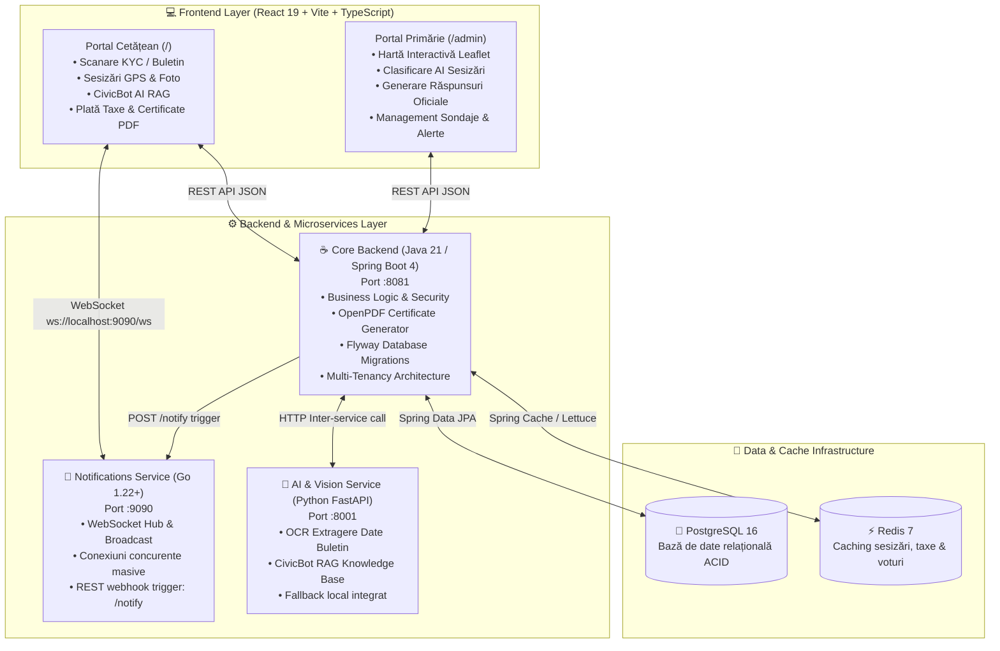

# 🏛️ CivicOS — Next-Generation AI-Powered Civic & E-Governance Platform

[](https://openjdk.org/)
[](https://spring.io/projects/spring-boot)
[](https://golang.org/)
[](https://fastapi.tiangolo.com/)
[](https://react.dev/)
[](https://www.typescriptlang.org/)
[](https://www.postgresql.org/)
[](https://redis.io/)
[](https://www.docker.com/)
[](https://tailwindcss.com/)

**CivicOS** este o platformă completă, distribuită, de e-Guvernare și implicare civică inteligentă (GovTech / Smart City). Sistemul digitalizează integral fluxul de comunicare dintre cetățean și primărie/administrația publică printr-o arhitectură modernă de microservicii poliglote (**Java Spring Boot**, **Go**, **Python FastAPI**, **React TypeScript**), asistată de inteligență artificială (RAG + OCR Buletine) și actualizări în timp real prin WebSocket.

---

## 🌟 Puncte Cheie & Valoare în Portofoliu (CV Highlights)

* **Arhitectură Poliglotă de Microservicii:** Proiectat conform bunelor practici din industria enterprise, folosind limbajul optim pentru fiecare domeniu:
  * **Java 21 / Spring Boot 4** pentru core business logic, tranzacții ACID, multi-tenancy și securitate.
  * **Go (Golang)** pentru microserviciul de streaming și notificări în timp real WebSocket cu performanță concurentă extremă.
  * **Python 3.12 / FastAPI** pentru procesarea documentelor (OCR Gemini) și asistență juridică AI prin RAG (Retrieval-Augmented Generation).
  * **React 19 + TypeScript Strict** pentru o experiență de utilizator fără cusur, cu zero erori de linter și hărți interactive geospațiale.
* **Separare Enterprise a Portalelor (Dual-Route Isolation):**
  * **Portalul Cetățeanului (`/`):** Scanare KYC automată, raportare incidente cu GPS și captură foto, asistent virtual CivicBot, plată taxe, programări la ghișeu și descărcare certificate PDF oficiale semnate electronic.
  * **Portalul Funcționarului / Primăriei (`/admin`):** Panou de control protejat, hartă interactivă a incidentelor (Leaflet GIS), clasificare automată AI pe departamente, generare de răspunsuri oficiale AI și emitere de alerte orășenești.
* **Toleranță la Erori & Reziliență:** Fallback-uri locale offline pentru AI, gestionare sigură a conexiunilor WebSocket cu auto-reconectare și `ErrorBoundary` complet pe interfețele vizuale.
* **Infrastructură & Performanță:** Caching multinivel cu Redis (TTL dedicat pe entități), migrații automate prin Flyway și scripturi de orchestrare `start.sh` / `stop.sh`.

---

## 🏛️ Arhitectura Sistemului



---

## 🚀 Tehnologii Utilizate

### 1. Backend Core ([`backend-core/`](file:///root/CivicOS/backend-core))
* **Java 21 LTS** & **Spring Boot 4.1.0**
* **Spring Data JPA & Hibernate 7** (Audit automat `Auditable`, entități relaționale)
* **Spring Security** (Autentificare bazată pe roluri și autorizare)
* **PostgreSQL 16** cu migrații controlate prin **Flyway**
* **Redis Cache** integrat prin `RedisCacheConfiguration` (serializare JSON optimizată)
* **OpenPDF (LibrePDF 2.0.1)** pentru generarea în timp real a documentelor oficiale cu watermark și ștampilă digitală
* **Spring Validation** (validare strictă a CNP-ului și datelor cetățenești)

### 2. Microserviciu Notificări ([`backend-notifications/`](file:///root/CivicOS/backend-notifications))
* **Go (Golang 1.22+)**
* Arhitectură concurentă cu **Goroutines** și **Channels**
* **Gorilla WebSocket** cu mecanism de `ClientHub`, heartbeat (ping/pong) și broadcast distribuit
* Endpoint HTTP intern `POST /notify` pentru trimiterea alertelor din Java către clienții conectați
* Teste automate unitare și de integrare (`go test -v ./...` 100% pass)

### 3. Modulul de Inteligență Artificială ([`backend-ai/`](file:///root/CivicOS/backend-ai))
* **Python 3.12** & **FastAPI** / **Uvicorn**
* **OCR Buletine Românești (CI):** Extragere structurată (CNP, Serie, Număr, Nume, Prenume, Adresă, Data Expirării)
* **CivicBot RAG (Retrieval-Augmented Generation):** Asistent virtual bazat pe ghidul legislativ municipal și codul rutier
* **Local Fallback Engine:** Garanție de funcționare și răspuns rapid chiar și fără conectivitate la API-uri externe

### 4. Frontend Modern ([`frontend/`](file:///root/CivicOS/frontend))
* **React 19** & **TypeScript Strict**
* **Vite** pentru bundle ultra-rapid și Hot Module Replacement
* **Tailwind CSS** & **Lucide React** pentru un UI modern, accesibil și receptiv
* **Leaflet & React-Leaflet** pentru vizualizarea geospațială interactivă a sesizărilor pe harta orașului
* **Speech-to-Text integrat:** Dicție vocală direct în browser pentru raportarea incidentelor
* Conexiune WebSocket nativă cu notificări toast automate la schimbarea stadiului cererilor

---

## 📦 Structura Monorepo-ului

```text
CivicOS/
├── backend-core/             # Spring Boot 4 Java Enterprise Core
│   ├── src/main/java/        # Controllers, Services, Repositories, Entities
│   ├── src/main/resources/   # application.properties, flyway db migrations
│   └── pom.xml               # Configurare Maven Java 21
├── backend-notifications/    # Microserviciu Notificări Go (WebSocket)
│   ├── handlers/             # HTTP & WS route handlers
│   ├── hub/                  # Goroutine-safe client manager & broadcast hub
│   ├── main.go               # Entrypoint microserviciu Go
│   └── Dockerfile            # Imagine multi-stage container
├── backend-ai/               # Microserviciu Python FastAPI
│   ├── main.py               # RAG chatbot & OCR extraction
│   └── knowledge_base.txt    # Baza de cunoștințe legislative & municipale
├── frontend/                 # Aplicație React 19 + TypeScript
│   ├── src/pages/            # Rute separate: CitizenPage.tsx și AdminPage.tsx
│   ├── src/types/            # Tipuri TypeScript stricte
│   ├── src/ErrorBoundary.tsx # Izolare automată a erorilor de randare
│   └── vite.config.ts        # Configurare Vite & Proxy dev
├── infra/                    # Docker Compose & servicii de bază (Postgres, MailHog)
├── start.sh                  # Script automat de pornire pentru toate serviciile
└── stop.sh                   # Script automat de oprire curată
```

---

## 🛠️ Ghid de Instalare și Rulare Rapidă

### Opțiunea 1: Orchestrare Locală Automată (Recomandat)

Scriptul inclus `start.sh` verifică dependențele, pornește baza de date și lansează toate cele 4 componente simultan:

```bash
# Acordare permisiuni de execuție
chmod +x start.sh stop.sh

# Pornire completă a ecosistemului CivicOS
./start.sh
```

După finalizarea pornirii:
* 🌐 **Portal Cetățean:** [http://localhost:5173/](http://localhost:5173/) *(autentificare instant cu un click pe "Ion Popescu" sau încărcare buletin)*
* 🛡️ **Portal Administrație (Primărie):** [http://localhost:5173/admin](http://localhost:5173/admin) *(parolă demo: `admin`)*
* 📡 **Notificări WebSocket:** `ws://localhost:9090/ws`
* ☕ **API Java Spring Boot:** `http://localhost:8081/api/v1/requests`
* 🐍 **Documentație OpenAPI AI:** `http://localhost:8001/docs`

Pentru oprirea curată a tuturor serviciilor:
```bash
./stop.sh
```

---

### Opțiunea 2: Pornire Individuală per Microserviciu

<details>
<summary><b>Click pentru instrucțiuni manuale detaliate</b></summary>

#### 1. Baza de Date & Cache
```bash
# PostgreSQL pe portul 5433 și Redis pe 6379
redis-server --daemonize yes
```

#### 2. Microserviciul Go WebSocket
```bash
cd backend-notifications
go build -o notifications .
./notifications
# Rulează pe portul 9090
```

#### 3. Modulul AI & OCR Python
```bash
cd backend-ai
python3 -m venv venv && source venv/bin/activate
pip install -r requirements.txt
uvicorn main:app --host 0.0.0.0 --port 8001
```

#### 4. Backend Core Spring Boot
```bash
cd backend-core
./mvnw spring-boot:run
# Rulează pe portul 8081
```

#### 5. Frontend React
```bash
cd frontend
npm install
npm run dev
# Rulează pe http://localhost:5173
```
</details>

---

## 🧪 Rulare Teste Automate

```bash
# Teste unitare și de concurență Go
cd backend-notifications && go test -v ./...

# Teste compilare și validare backend Java
cd backend-core && ./mvnw test

# Verificare tipuri TypeScript și Linter frontend
cd frontend && npm run lint && npx tsc --noEmit
```

---

## 🔒 Securitate & Bune Practici

* **Validare la nivel de API:** Toate cererile sunt sanitizate și validate atât pe frontend (TypeScript interfaces), cât și pe backend (Jakarta Validation).
* **Izolare Multi-Tenant:** Arhitectură pregătită pentru scalare multi-oraș prin entitatea `Tenant` și izolarea datelor per municipalitate.
* **Fără expunere de secrete:** `.gitignore` este configurat să excludă mediile virtuale (`venv`), cheile private, artefactele de build (`target/`, `dist/`) și bazele de date locale.

---

## 📄 Licență

Acest proiect este licențiat sub licența **MIT** — liber pentru utilizare, învățare și extindere în scopuri educaționale și profesionale.

---

<p align="center">
  Construit cu pasiune pentru modernizarea administrației publice și transformarea digitală a orașelor inteligente.
</p>
